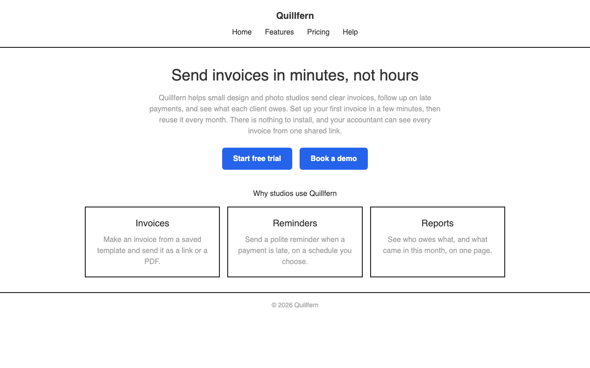

# deskcrit

A Claude Code plugin that critiques a screenshot of a design the way a senior design director would, and gives your coding agent a ranked list of fixes.

deskcrit is for people who build UI with Claude Code and want a second opinion on how the result looks before they ship it. The critic checks the image against about 210 guidelines from an approved reading list (Bringhurst, Müller-Brockmann, Tufte, WCAG, Nielsen Norman Group, and others, listed in [GUIDELINES.md](GUIDELINES.md)), plus 38 signs that a page came from an AI template, adapted from Damir Sokolovsky's unslop. It writes its findings as what a viewer of the page experiences, and it names the source of each rule.

Status: in development. The repository is private, so you need read access to install the plugin.

## What you get

Given this page:



The critic writes a crit like this (shortened; the full text is in [crit.md](evals/critic/work-order/bad-page/crit.md)):

> **Verdict.** It doesn't do its job yet. The case for the product (studios, late-payment follow-up, a shared link for your accountant) sits in grey text that fails contrast, so the visitor sees only a generic headline and two buttons asking for the same level of commitment.
>
> **What would move it most**
> 1. **The copy that sells the product is the faintest thing on the page.** The lead paragraph, all three card descriptions and the footer are `#a3a3a3` on white at 2.52:1, well under the 4.5:1 minimum (WCAG 1.4.3). [...] Fix: darken the body text to at least 4.5:1.
> 2. **Two equal primary buttons.** "Start free trial" and "Book a demo" are the same filled blue at the same 152×48 size, so the visitor has to choose between them with no hint which one the page wants. [...]

Each crit also has a first read, the page's purpose as the critic understands it, smaller issues, what works, and what it could not judge from a still image.

It also writes `work-order.json`, which a coding agent can act on: one entry per ranked finding, with the place on the page (a CSS selector and a pixel box when the page was measured), the current value, the target, and the source. See [work-order.json](evals/critic/work-order/bad-page/work-order.json) for the same page.

## Requirements

- [Claude Code](https://claude.com/claude-code).
- Node.js 22 or later.
- Optional: the `playwright` package and its Chromium in the project you work in. With them, the critic measures the page (font sizes, line lengths, contrast, target sizes) in place of estimating from pixels. Install them with `npm install playwright` and `npx playwright install chromium`.

If Playwright is missing, the skills show you the install commands and ask before they install anything. If you say no, the critic works from the image alone and says so in its answer. Its contrast and size findings are then estimates, not measurements.

## Install

1. In Claude Code, add the marketplace. You need read access to `benjaminjackson/deskcrit` and git credentials for GitHub:

   ```
   /plugin marketplace add benjaminjackson/deskcrit
   ```

2. Install the plugin:

   ```
   /plugin install deskcrit@deskcrit
   ```

3. Run `/plugin` and check that the `crit-loop` and `design-critic` skills are listed.

## Use

The plugin has two skills. You start them by asking in plain words, or by name.

**Critique one image.** Give Claude a screenshot, mockup, poster, slide, or chart and ask for a crit:

```
/deskcrit:design-critic ~/Desktop/checkout.png
```

or "crit this screenshot". If you also give the page's URL or HTML file, the critic measures the page first. The skill saves `crit.md` and `work-order.json` next to the image (or next to the measured facts) and tells you the path of the work order.

**Give it a brief.** A brief makes the crit sharper. Say what you know in plain words, or name a file that holds it. The skill sorts it into eight fields: the job, the audience, where and how people see it, the message, brand and tone, what is fixed, how finished it is, and the feedback you want. For the first five you can also say what the piece is not going for. The fields and the sorting rules are FR-87 in `docs/PRD.md`. For example:

```
/deskcrit:design-critic ~/Desktop/pricing.png It's for small design studios on a laptop. We want sign-ups, not demo bookings. The footer must say "© 2026 Quillfern Ltd". It's a first draft; skip the footer for now.
```

The critic does not suggest a change to what is fixed or a change toward what the piece is not going for. With `crit-loop`, the brief you give in round 1 applies to every round, and a decision you make about a finding during the loop is added to it.

**Keep one brief for the whole project.** To give every crit and every loop in a project the same brief, write it to `.deskcrit/brief.md` in the folder you run Claude Code from. Put one line per field, such as `Audience: Small design studios on a laptop.`, with the field names `Job`, `Audience`, `Setting`, `Message`, `Brand and tone`, `Fixed`, `Stage`, and `Ask`, and the "not" lines `Job, not` to `Brand and tone, not`. You can commit the file with your code. When your request also gives a field, your request wins for that field, and the file's other fields still apply. Blank lines and lines that start with `#` are skipped. Any other line with a field name the skill does not know, or a field given twice, stops the run with one line that names it. With `crit-loop`, when you say a decision holds "for the whole project" or "everywhere", the loop also writes it to `.deskcrit/brief.md`, and creates the file if it is not there; a decision about one page stays with that loop. At the stop, the loop names each line of the file that it overrode for that page. The rules are FR-88 in `docs/PRD.md`.

**Name the real thing a mock shows.** When the design shows a mock of something real, such as a report, an app screen, or a product, give the path of the real one (an image or a PDF) in your request, and the critic checks the mock against it. Without one, the crit says what it could not check. The skill never searches your disk for one.

**Compare several images.** Give it 2 to 12 images and say which check you want:

- "Are these consistent?" gives a consistency check that names each screen that breaks a pattern the others keep.
- "Which is best?" gives a best pick, ranked by how well each version does its job.

Each image also gets its own crit and work order. If you say the images are slides of one deck or screens of one flow, the skill runs the consistency check. Otherwise, if you do not say which check you want, or the images could be versions of one design, the skill asks. If another agent calls the skill and does not name the check, the skill refuses with one line, except for slides of one deck or screens of one flow.

**Fix a page in a loop.** After Claude changes UI code, ask it to check the design and fix it, or run:

```
/deskcrit:crit-loop
```

Each round captures the page, fixes every finding of the work order, the most important first, captures again at the same viewports as round 1 (four by default), and starts a fresh critic that marks each finding closed, open, or worse, or settled when you decided to keep it as it is. The loop stops when the fresh critic lists no finding, ranked or smaller, or when two rounds in a row close nothing. It does not add content to close a finding. When a fix needs a fact that only you have, such as a name, a date, or a number, the critic asks for it in the finding, and the loop asks you for every such fact in one question per round. It puts your answers in the brief and uses them exactly as you gave them. It does not ask again for a fact you did not give, and it lists that fact when it stops. A finding that waits only for such a fact does not keep the loop running. When a matter of taste has two or three good fixes, the critic offers you a choice, and the loop asks it in the same question as the facts. It writes your pick in the brief and does not fix the options you did not pick. When you do not answer, it takes the critic's first option, notes in the brief that the loop picked it, and names it when it stops. It never asks a choice about a problem it measures, such as low contrast or a small target, and it fixes those without asking.

For a deck or a flow of screens, give the deck as one HTML file whose hash anchor picks the slide, such as `deck.html#3` for slide 3. For each slide the loop captures only the element whose id the hash names, also when the hash only scrolls. Each round critiques every slide and checks the slides for consistency on one contact sheet, and the loop fixes each break that the consistency check names. When a slide's crit and the consistency check ask for opposite changes, the slide keeps the deck's pattern, and a change to the pattern itself comes to you as a proposal at the end. It stops when no slide has a finding left, ranked or smaller, and the consistency check finds no break, or when two rounds in a row close nothing. Facts work as they do for a page: one question per round covers every slide, and the consistency check may ask for a fact to fill a slide that a cut left too thin. A slide that waits only on a fact you did not give does not keep the loop going.

The critic only critiques. It does not edit files.

## Develop

This repository holds the plugin, the guideline packs with their test images, and the evaluations of the critic. The npm package is development tooling only. It has no command and is not published.

```
npm ci
npm run ci          # lint, type check, unit tests
```

| Path | What it holds |
| --- | --- |
| `plugin/` | The plugin: both skills, their agents, scripts, and references. [plugin/README.md](plugin/README.md) explains the scripts. |
| `GUIDELINES.md` | The catalog of guidelines, each with its rule and source. |
| `packs/` | Eight guideline packs, each with criteria and rendered test images. [packs/README.md](packs/README.md) explains how to render them. |
| `schemas/` | JSON Schemas for packs, measured facts, and work orders. |
| `evals/` | Evaluations of the critic, with saved crits that replay without a model call. |
| `docs/PRD.md` | The specification. It decides what the code must do. |
| `docs/CONSTITUTION.md` | The coding standards. |

Notes for changes:

- `plugin/skills/design-critic/references/` is built, not written by hand. After you change `checklist.yaml`, `GUIDELINES.md`, or a `pack.yaml`, run `ruby plugin/skills/design-critic/scripts/build.rb` from the repository root (Ruby 3.0 or later). `npm run ci` fails if the committed references differ from a fresh build.
- The scripts under `packs/` and `evals/measure/` that render pages need their own install: `npm --prefix packs ci`, then `npm --prefix packs run setup`.
- `npm run ci` never calls a model. The `npm run eval:critic:*` scripts replay saved crits. To make new crits, run the scripts in `evals/critic/` without `--replay`; these start `claude -p` and use your plan's usage.
- `npm run eval:loop-tells` replays the saved runs of the fix loop on the pages in `evals/loop-tells/` (EV-25) with no model call. `node evals/loop-tells/run.ts run` and `score` make new runs and judge answers; they start `claude -p` and use your plan's usage.

## License

MIT. See [LICENSE](LICENSE).

## Credits

The Template tells section of the guideline catalog adapts [unslop](https://github.com/heydamir/unslop) by Damir Sokolovsky (@heydamir), [CC BY 4.0](https://creativecommons.org/licenses/by/4.0/), skills/unslop/references/signs.md and one line of skills/unslop/SKILL.md at commit 620163e. Changes: each sign is rewritten as a rule and a yes-or-no question, fixes are reworded, two pairs of duplicate signs are merged, emoji are written as words in square brackets, the Copy, Motion, Spacing, and Right to left groups are left out, and some single signs of the Landing pages, Visuals, and Template look groups are left out.
